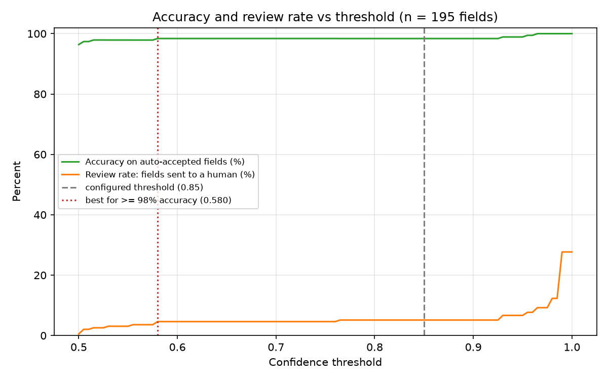
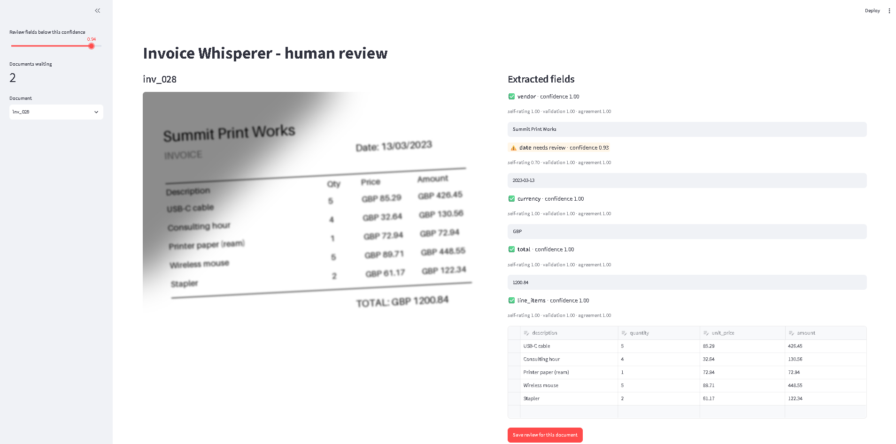

# Invoice Whisperer

**Extract invoice data with a vision LLM and send only the uncertain fields to a human.**

> **Headline:** on 48 synthetic invoices (240 fields), **91.7% of fields skipped human review at 100% accuracy**, with 0 confident errors. The confidence floor was tuned on 39 of these documents; on 9 held-out documents it also gave 100% accuracy with 95.6% skipping review, but that slice is small (45 fields). See [Limitations](#limitations).



## The problem

Businesses receive invoices as photos, scans and PDFs in every layout, and someone retypes the data. Invoice Whisperer extracts the fields automatically and asks a human to check only the parts it is unsure about.

## How it works

```
image / PDF -> ingest -> pre-process -> extract (2 passes) -> validate -> confidence -> route -> review UI -> SQLite -> evaluate
```


1. **Ingest:** images and PDFs (PyMuPDF renders PDF pages).
2. **Pre-process:** deskew, shadow removal (illumination flattening), resize and JPEG-encode under the API size limit.
3. **Extract:** a Groq-hosted vision model (`qwen/qwen3.8-27b`) returns JSON with a self-rated confidence per field. Two passes use different prompts and temperatures.
4. **Validate:** Pydantic parsing plus rules (real calendar dates, row maths, line items sum to the total).
5. **Confidence per field** blends three signals: `0.25 x self-rating + 0.35 x validation + 0.40 x agreement between the two passes`. Two caps force review: a failed validation, or a self-rating below `SELF_FLOOR` (0.90).
6. **Route:** fields at or above the threshold (default 0.85) are auto-accepted. The rest go to a review queue.
7. **Review UI:** a Streamlit page shows the invoice beside the fields, with uncertain ones highlighted and editable.
8. **Store and evaluate:** SQLite keeps the model value and the human value separately, so corrections never overwrite what the model said.



The model name, threshold, self-rating floor and rate limits are all config values in `.env`.

## Results

Synthetic data with ground-truth labels: 48 invoices, 240 fields, four noise levels.

| Metric (threshold 0.85, `SELF_FLOOR` 0.90) | Value |
|---|---|
| Field accuracy (model only, before any review) | 96.7% |
| Exact-match total | 95.8% |
| Auto-accept rate (fields skipping review) | 91.7% |
| Accuracy on auto-accepted fields | 100.0% |
| Confident errors (wrong and auto-accepted) | 0 |
| Correction rate (human changed a value) | 5.0% (1 of 20 reviewed fields) |
| Final field accuracy after human review | 97.1% |

| Noise level | Documents | Field accuracy | Auto-accept rate |
|---|---|---|---|
| clean | 19 | 98.9% | 96.8% |
| mild | 13 | 100% | 96.9% |
| ugly | 8 | 100% | 97.5% |
| brutal | 8 | 82.5% | 65.0% |

**Tuned vs held-out.** The self-rating floor and threshold were chosen on the first 39 documents, so those numbers are tuned, not validated.

| Slice | Documents | Fields | Skip review | Accuracy on auto fields | Confident errors |
|---|---|---|---|---|---|
| Tuned | 39 | 195 | 90.8% | 100% | 0 |
| Held-out (clean only) | 9 | 45 | 95.6% | 100% | 0 |

## What broke

Before the self-rating floor existed, three wrong fields were auto-accepted at threshold 0.85. All three had a model self-rating below 0.90, but the blended score hid it.

- **Day/month swap (`inv_010`):** a `DD/MM/YYYY` date was read as `MM/DD`. The two passes agreed with each other, so agreement could not catch it. The ground truth uses `DD/MM`, which no model can infer from the image. Self-rating was 0.70.
- **Shared digit misread (`inv_046`):** `2023-03-05` was read as `2023-03-06` on a degraded scan. Both passes made the same mistake, and a wrong date is still a valid date, so validation could not catch it. Self-rating was 0.80.
- **Wrong item name (`inv_045`):** the model wrote "Packaging tape" where the label says "Packing tape". Every amount was right, but the strict line-item match counts it as wrong. Self-rating was 0.85.

**Lesson:** two passes from the same model share the same blind spots, so agreement is a weak signal on its own. The model's own self-rating was the most informative signal. On the first 39 documents, fields rated below 0.90 were wrong about 43% of the time (6 of 14), against about 1% above it (2 of 181). Adding the floor removed all three confident errors at a cost of about 4 points of review rate.

**Human review is not a cure-all.** Of 20 fields sent to review, 8 were real model errors, and the reviewer corrected only 1. On blurry, low-resolution scans a 9 and a 0 are nearly indistinguishable, and the review page shows scores but not why a field was flagged.

## Limitations

- **Synthetic data only.** Real invoices have taxes, discounts, multiple pages and stranger layouts. The "line items sum to total" rule assumes none of these.
- **Small sample.** 240 fields and 8 wrong model values. A single error moves accuracy by about 0.4 points, and the threshold sweep is coarse.
- **Tuned on the same data.** The 0.90 floor was picked after seeing the errors it fixes. The held-out slice (9 documents, all clean) is consistent with it working but cannot show it generalises, especially to brutal scans, where nearly all errors occurred.
- **Strict line-item scoring.** Descriptions must match exactly, so a one-word misread fails the whole field.
- **One model.** Results are for `qwen/qwen3.8-27b` on Groq's free tier. Other models will differ.
- **Free-tier limits shaped the project.** The pipeline uses a token-per-minute limiter, retries with backoff, an on-disk response cache and a clean stop at the daily limit.

## Setup

Windows with Git Bash shown. Python 3.12.

```bash
git clone https://github.com/MadhusudanDesai1/invoice-whisperer.git
cd invoice-whisperer
python -m venv .venv
source .venv/Scripts/activate
pip install -r requirements.txt
pip install -e .
cp .env.example .env     # then add your GROQ_API_KEY and GROQ_MODEL
python scripts/check_connection.py
```

## Usage

```bash
python scripts/generate_data.py 40        # base synthetic set
python scripts/generate_hard.py 8         # harder invoices
python scripts/run_batch.py --noise clean --limit 5   # small first run (about 10 API calls)
python scripts/evaluate.py
python scripts/sweep.py --target 0.99
streamlit run src/invoice_whisperer/review_app.py
python -m pytest -q
```

Free-tier note: the daily token limit allows roughly 40 invoices a day with two passes each. Responses are cached, so re-runs are free and an interrupted batch resumes where it stopped. Running the full 48 takes two days.

## Project layout

## License

MIT
